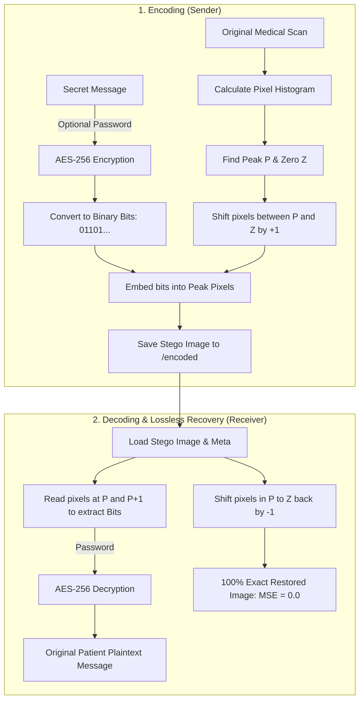

# How It Works: Simple Explanation of Reversible Data Hiding

This document explains the project in **plain, simple language** with visual diagrams—perfect for answering viva questions or explaining the project to your professor in 2 minutes.

---

## 1. The Core Idea in 30 Seconds (The "Bookshelf" Analogy)

Imagine a bookshelf packed with numbered books from `0` to `255`:
* **Normal Steganography:** Replaces book `#48` with your secret note. When you take your note out, the original book is gone forever (permanent damage).
* **Reversible Data Hiding:** 
  1. Finds the most common book number (let's say `#48`, the **Peak**).
  2. Finds an empty spot on the shelf (let's say `#150`, the **Zero**).
  3. Gently slides all the books between `#49` and `#149` one step to the right ($+1$).
  4. Now spot `#49` is completely empty!
  5. If your secret bit is `1`, you move a `#48` book into spot `#49`. If the bit is `0`, you leave it at `#48`.
  6. **To restore:** You read your secret bits, then slide all the books back one step to the left ($-1$). **The shelf is 100% identical to how it started!**

---

## 2. Visual Histogram Graph (How the Pixels Shift)

### Before Hiding (Original Image Histogram)
```text
Frequency
   ▲
   │        ██ (Peak P = 48)  <-- Most common pixel shade
   │        ██
   │     ██ ██ ██
   │  ██ ██ ██ ██ ██             (Zero Z = 150) <-- Empty or rare shade
   │  ██ ██ ██ ██ ██ ........     ░░
───┴──┴──┴──┴──┴──┴───────────────┴────────► Pixel Values (0 to 255)
            48 49 50            150
```

---

### Step 1: Shift Intermediate Pixels by +1 to Open an Empty Gap
All pixels between 49 and 149 are shifted by $+1$.
Notice how value **49 is now completely empty (a vacant slot)**!

```text
Frequency
   ▲
   │        ██ (Peak P = 48)
   │        ██    [EMPTY GAP]
   │     ██ ██       ██ ██
   │  ██ ██ ██       ██ ██ ██
   │  ██ ██ ██       ██ ██ ██ ......
───┴──┴──┴──┴───┬───┴──┴──┴─────────────► Pixel Values (0 to 255)
            48  49  50 51
```

---

### Step 2: Embed Secret Bits into the Peak Pixels
We look at our secret bits (`0` or `1`):
* If secret bit = **`0`** $\rightarrow$ leave pixel as **`48`**.
* If secret bit = **`1`** $\rightarrow$ change pixel to **`49`** (into the empty gap).

```text
Frequency
   ▲
   │        ██ (Bit 0s stay at 48)
   │        ██   ██ (Bit 1s move to 49)
   │     ██ ██   ██  ██ ██
   │  ██ ██ ██   ██  ██ ██ ██ ......
───┴──┴──┴──┴───┴───┴──┴──┴─────────────► Pixel Values (0 to 255)
            48  49  50 51
```

> **Why the image still looks normal:** Changing a pixel by just $+1$ shade is completely invisible to human eyes (PSNR $> 50$ dB), but mathematically allows perfect recovery!

---

## 3. Step-by-Step Encoding & Decoding Process



### The Encoding Steps:
1. **Load Image:** Read the medical scan as grayscale (values from 0 to 255).
2. **Encrypt Payload:** If a password is entered, encrypt the text using AES-256 (see Section 4 below).
3. **Analyze Histogram:** Find the most frequent pixel value ($P$) and an empty/rare pixel value ($Z$).
4. **Shift:** Shift pixels between $P$ and $Z$ by $+1$ to open an empty bin next to $P$.
5. **Embed:** For each pixel equal to $P$, change it to $P+1$ if the secret bit is `1`, or keep it $P$ if `0`.
6. **Save:** Save the resulting image as a lossless `.png` in the `encoded/` folder.

### The Decoding Steps:
1. **Read Bits:** Inspect pixels at $P$ and $P+1$. If pixel is $P+1$, record bit `1`; if $P$, record bit `0`.
2. **Decrypt Payload:** Use the password to turn the binary bits back into readable text.
3. **Reverse Shift (Image Recovery):** Shift all pixels in the range back by $-1$.
4. **Exact Match Verification:** Compare the restored image with the original image:
   $$\text{MSE} = 0.000000 \quad | \quad \text{PSNR} = \infty$$

---

## 4. How the Password is Used to Encrypt the Data

Steganography only **hides** where the data is, but if an unauthorized person discovers the algorithm, they could read the patient's private records. Adding a **password** provides a second layer of defense.

Here is how the password works under the hood:

```text
[User Password: "mySecret123"]
       │
       ▼
[PBKDF2-HMAC-SHA256 Key Derivation] + [Random Salt]
       │
       ▼
[256-bit Cryptographic Key] (32 bytes of high-entropy math)
       │
       ▼
[AES-256-GCM Encryption] + [Random Nonce]
       │
       ▼
[Encrypted Ciphertext: e8 3a 9f c1 ...] (Looks like random static noise)
       │
       ▼
[Embedded into Image via Histogram Shifting]
```

### Why this is secure:
1. **Key Derivation (PBKDF2):** We don't use your password directly. We run it through 10,000 rounds of hashing with a random 16-byte "salt". This prevents attackers from guessing simple passwords using dictionary attacks.
2. **AES-GCM (Authenticated Encryption):** 
   * It encrypts the text into scrambled bytes that look like pure random noise.
   * If someone tries to enter the wrong password, decryption fails instantly and alerts you.
3. **Two-Layer Security:** 
   * Layer 1 (Steganography): An attacker doesn't even know data is inside the image.
   * Layer 2 (Cryptography): Even if they extract the raw bits, they can't read a single word without the password.
